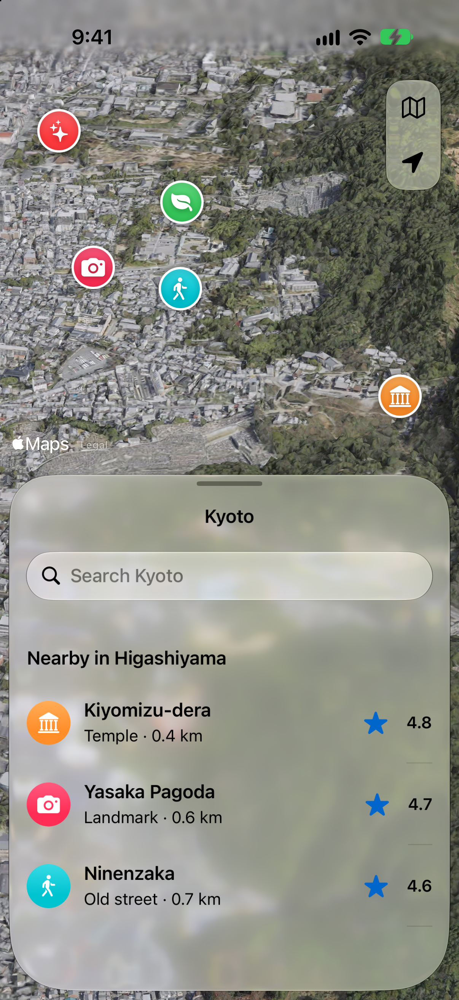
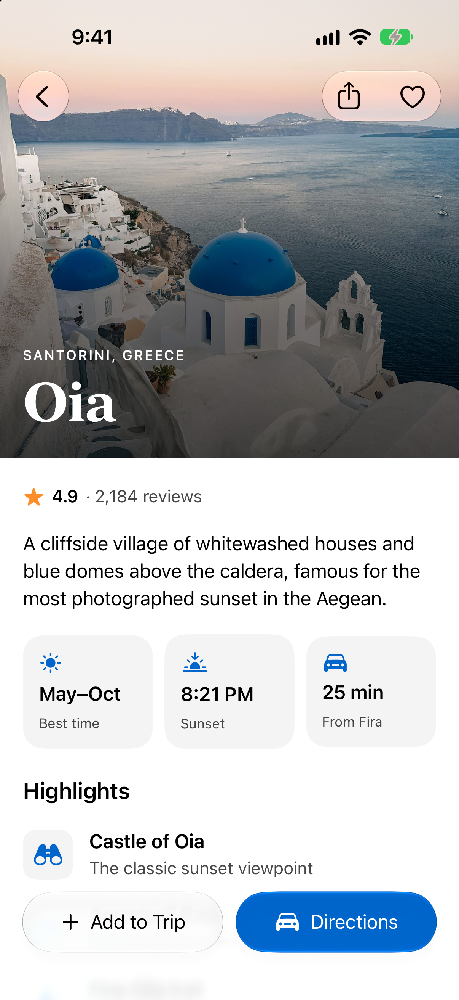
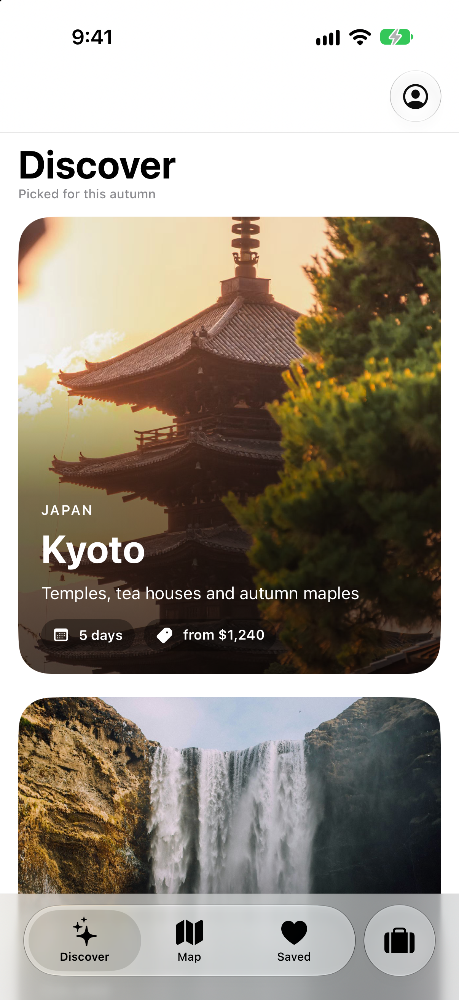
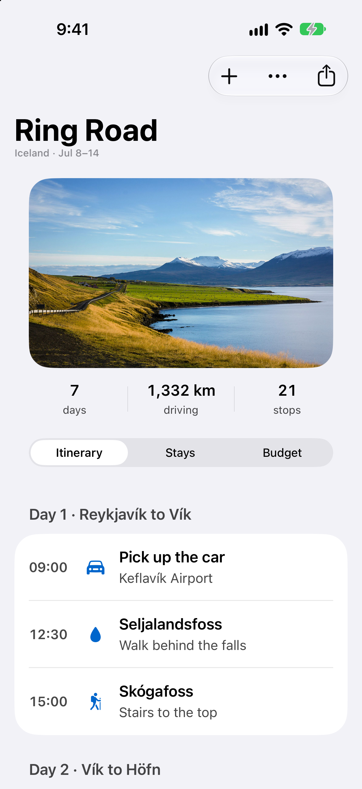
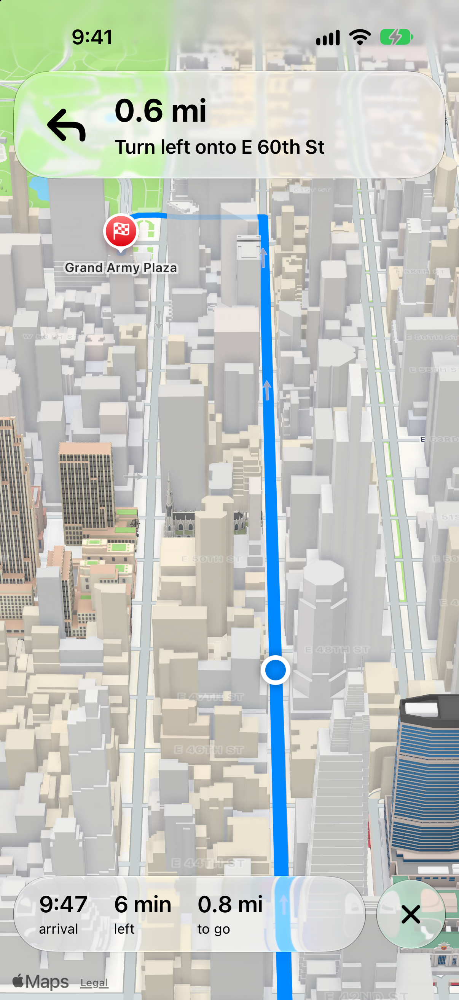
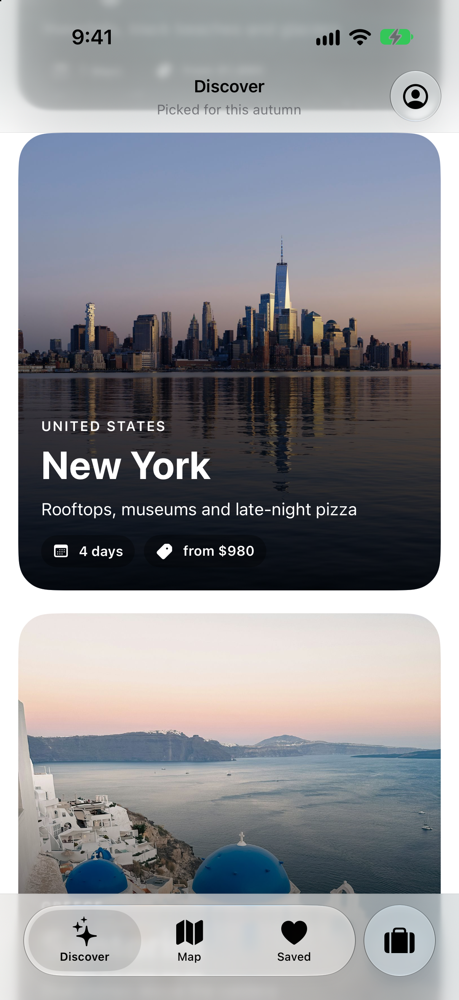

# Liquid Glass travel showcase

Six SwiftUI screens (and one scrolled variant) that show Apple's Liquid Glass on iOS 27: a satellite map with floating glass controls and a glass sheet, glass toolbars over photography, the iOS 27 prominent tab and toolbar APIs, turn-by-turn glass over a live map, and a booking sheet. It's a showcase for the [liquid-glass](https://github.com/heyparsadev/liquid-glass-skill) plugin for Claude, which teaches Claude the APIs and rules these screens follow.

| Explore | Place | Discover |
|---|---|---|
|  |  |  |

| Trip | Navigation | Booking |
|---|---|---|
|  |  |  |

| Discover, scrolled |
|---|
|  |

Dark-mode versions are in [`screenshots/dark`](screenshots/dark).

## What each screen shows

| Screen | Liquid Glass |
|---|---|
| Explore | Custom glass map controls in one `GlassEffectContainer`, unioned into one shape; a system sheet at a partial detent |
| Place | System toolbar items over a full-bleed photo; `.glass` and `.glassProminent` in a `safeAreaBar` |
| Discover | `TabView` with the iOS 27 `TabRole.prominent` tab and `tabBarMinimizeBehavior` |
| Trip | iOS 27 `.topBarPinnedTrailing`, `visibilityPriority`, `toolbarOverflowMenu`, and `.pickerStyle(.tabs)` |
| Navigation | Custom glass banner and trip bar over a MapKit route, separate shapes in one container |
| Booking | A task sheet: Cancel on the leading edge, one prominent Reserve on the trailing edge |

## Run it

Requires Xcode 27, [XcodeGen](https://github.com/yonaskolb/XcodeGen) (`brew install xcodegen`), and an iOS 27 simulator.

```sh
xcodegen generate
open Showcase.xcodeproj
```

Without a launch argument the app opens a list of the screens: tap one to open it, and tap **Screens** at the top to come back. Each screen also opens directly with a launch argument: `-screen 1` to `-screen 6`, and `-screen 7` is Discover scrolled down.

## Regenerate the screenshots

```sh
scripts/capture.sh                 # all seven, light and dark
scripts/capture.sh --only 02-place # one screen
```

The script builds the app and pins the simulator status bar to 9:41. It captures each screen in both appearances, then checks the images. The checker catches missing, blank, or wrong-size images, and a map that hasn't finished loading.

## Readability

Text and icons over glass, photos and maps measure at least 4.5:1 (WCAG AA) for text and 3:1 for icons, in light and dark. Three kinds of text are drawn by iOS and an app can't restyle them, so they are the exceptions: the search field's placeholder on Explore (3.8:1 light, 2.6:1 dark), the navigation subtitles on Trip and Discover (3.3:1 on the light background), and MapKit's "Legal" attribution on both map screens (about 2.5:1).

What keeps the rest above the bar:

- On glass, text is `.primary` and the hierarchy comes from size and weight. The system `.secondary` measured 2.3–3.9:1 there.
- On opaque content, `Color.supporting` (`Sources/App/SupportingText.swift`) replaces `.secondary` for subtitles and captions: the system style is 3.3:1 on the light grouped background.
- The accent color is `#0066CC`. A white label on the system blue measures 3.2–3.5:1, on this one 5.6:1.
- `SheetScrim` (`Sources/App/SheetScrim.swift`) sinks the backdrop by 40% under the system sheet in dark mode only. The sheet material takes on the colors behind it, and over bright imagery primary text was at 4.2:1. The skill says regular glass needs no dimming, so this is a deliberate trade for photo and map backdrops.
- Where a pale photo sits under the status bar and toolbar (Place), the toolbar uses the dark glyphs in both appearances. On Explore the status bar does too, over the map's haze.

## Notes

- MapKit draws no markers or annotations on the realistic imagery style in the iOS 27 simulator, so the pins on Explore are SwiftUI views placed with `MapProxy`. The other map screen uses the standard style, where `Marker`, `Annotation` and `MapPolyline` all draw.
- The screens are laid out and captured for the iPhone 18 Pro (402 × 874 pt). Other sizes aren't tuned: the Booking photo is scaled to clear the half-height sheet, and the Explore camera is fitted to this screen.
- Map tiles need up to 15 seconds to load. The capture script waits 25 seconds on the map screens and the checker fails if the map is still gray.

## Credits and license

Photos are from Unsplash, used under the Unsplash License. See [CREDITS.md](CREDITS.md). Code is MIT. See [LICENSE](LICENSE).
