# Liquid Glass travel showcase

Six SwiftUI screens (and one scrolled variant) that show Apple's Liquid Glass on iOS 27: a satellite map with floating glass controls and a glass sheet, glass toolbars over photography, the iOS 27 prominent tab and toolbar APIs, turn-by-turn glass over a live map, and a booking sheet. It's a showcase for the [liquid-glass](https://github.com/heyparsadev/liquid-glass-skill) plugin for Claude, which teaches Claude the APIs and rules these screens follow. The iOS 27 update of the plugin is on its [`claude/ios27-liquid-glass-update`](https://github.com/heyparsadev/liquid-glass-skill/tree/claude/ios27-liquid-glass-update) branch; its main branch is still the iOS 26 version.

| Explore | Place | Discover |
|---|---|---|
| [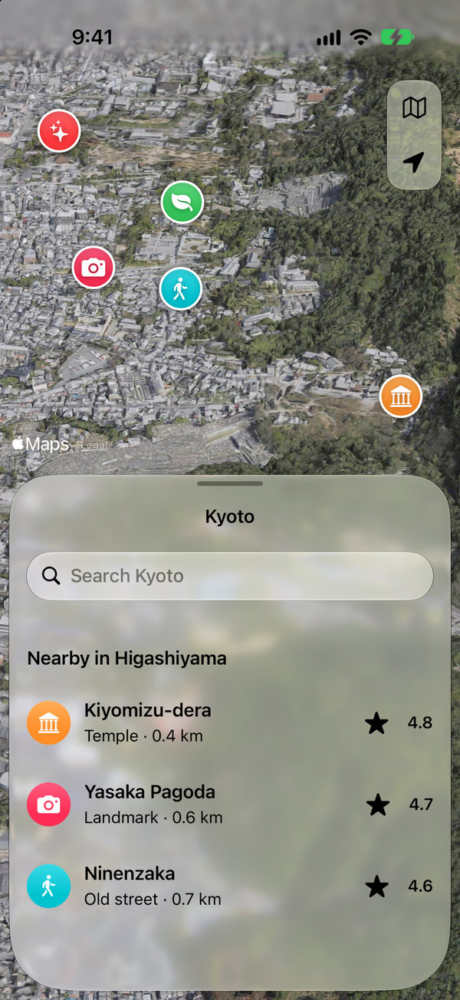](screenshots/light/01-explore.png) | [](screenshots/light/02-place.png) | [](screenshots/light/03-discover.png) |

| Trip | Navigation | Booking |
|---|---|---|
| [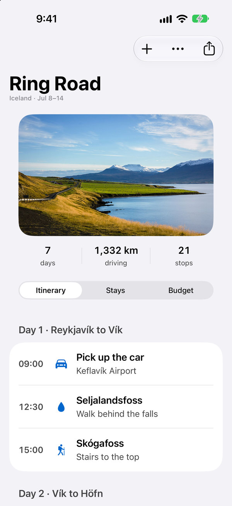](screenshots/light/04-trip.png) | [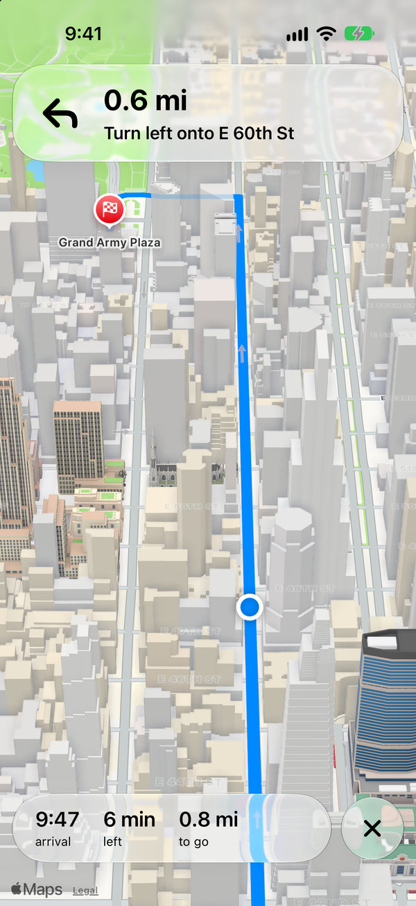](screenshots/light/05-navigation.png) | [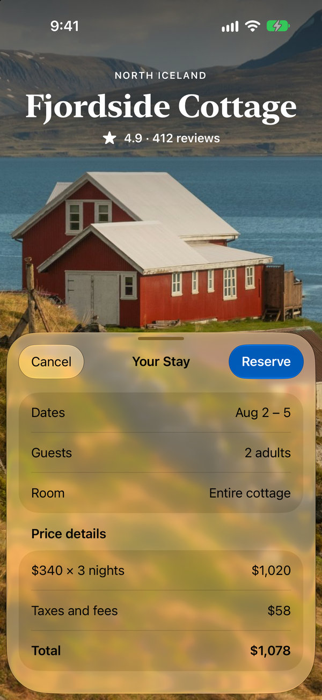](screenshots/light/06-booking.png) |

| Discover, scrolled |
|---|
| [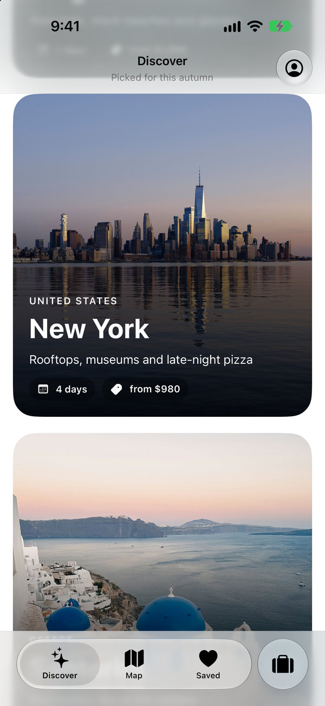](screenshots/light/07-discover-scrolled.png) |

<details>
<summary>Dark mode</summary>

| Explore | Place | Discover |
|---|---|---|
| [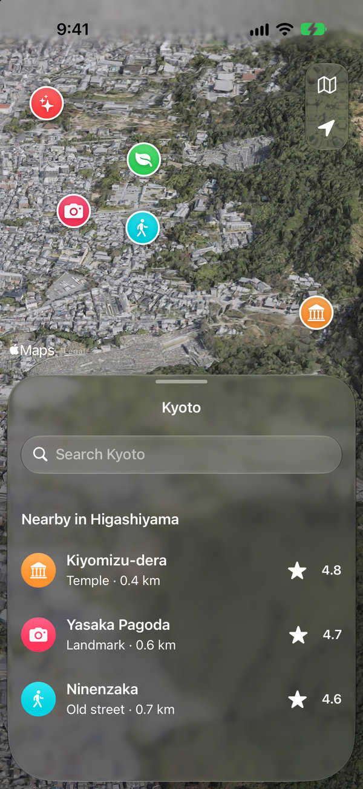](screenshots/dark/01-explore.png) | [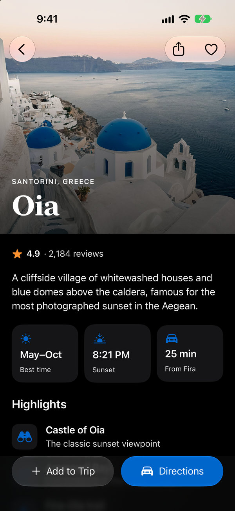](screenshots/dark/02-place.png) | [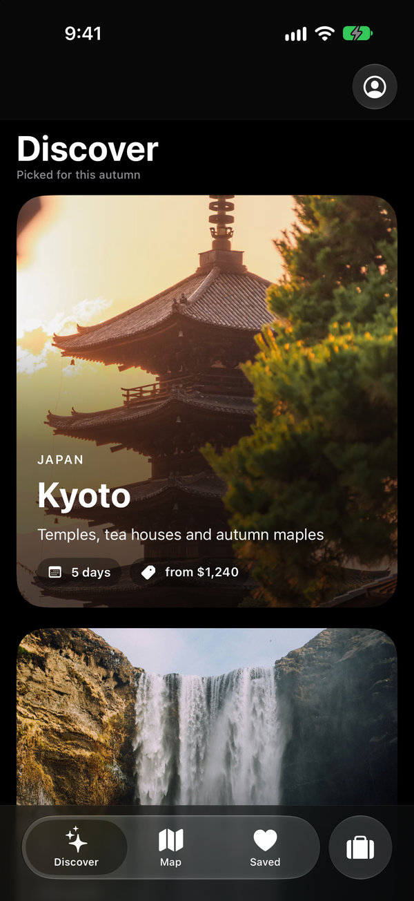](screenshots/dark/03-discover.png) |

| Trip | Navigation | Booking |
|---|---|---|
| [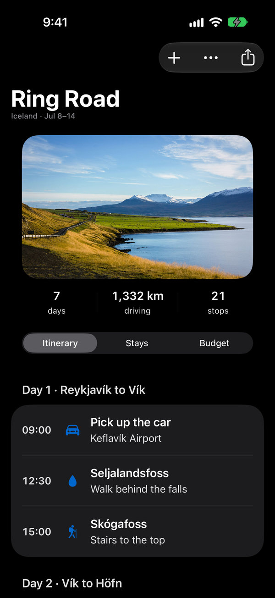](screenshots/dark/04-trip.png) | [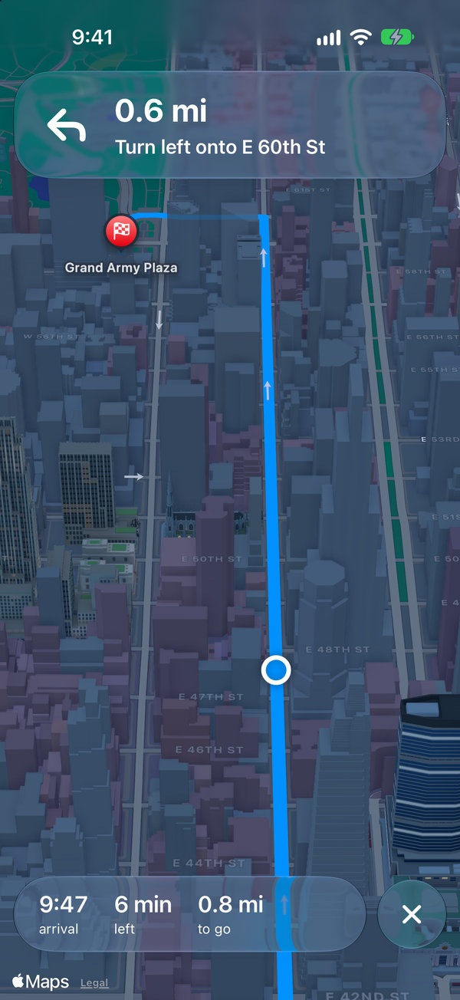](screenshots/dark/05-navigation.png) | [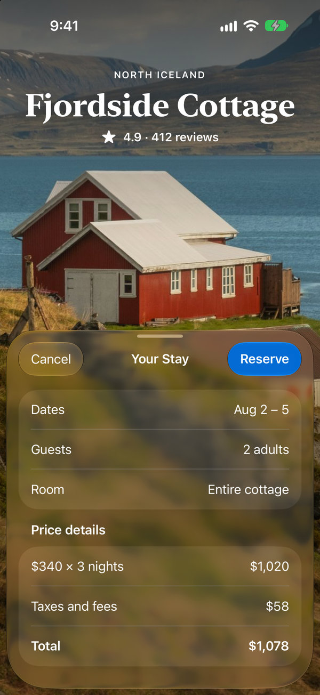](screenshots/dark/06-booking.png) |

| Discover, scrolled |
|---|
| [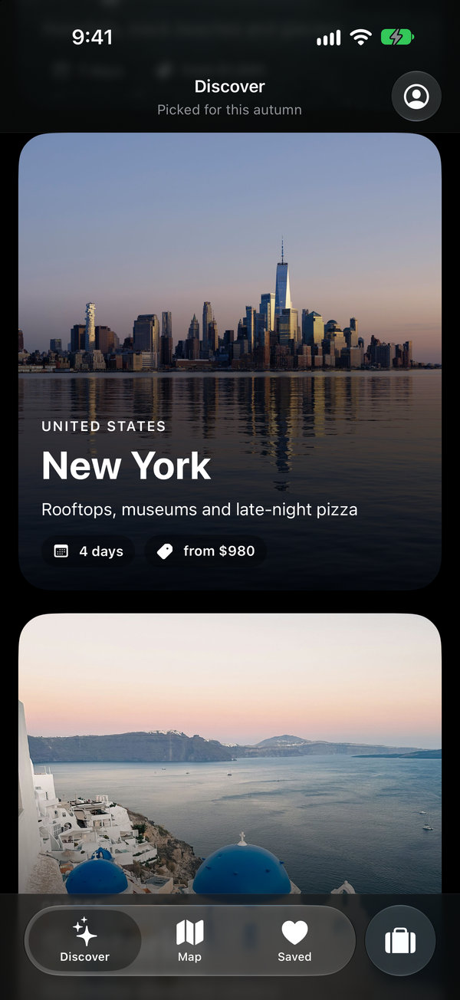](screenshots/dark/07-discover-scrolled.png) |

</details>

The images above are 600 px JPEG copies; each links to the full-size PNG (1206 × 2622) in [`screenshots`](screenshots).

## What each screen shows

| Screen | Liquid Glass |
|---|---|
| Explore | Custom glass map controls in one `GlassEffectContainer`, unioned into one shape; a system sheet at a partial detent |
| Place | System toolbar items over a full-bleed photo; `.glass` and `.glassProminent` in a `safeAreaBar` |
| Discover | `TabView` with the iOS 27 `TabRole.prominent` tab and `tabBarMinimizeBehavior`. The tab bar shrinks only when a finger scrolls, so no screenshot shows it minimized |
| Trip | iOS 27 `.topBarPinnedTrailing`, `visibilityPriority`, `toolbarOverflowMenu`, and `.pickerStyle(.tabs)` |
| Navigation | A glass maneuver banner, and a trip-status capsule beside a destructive End button in one `GlassEffectContainer`, over a MapKit route |
| Booking | A task sheet: Cancel on the leading edge, one prominent Reserve on the trailing edge |

## Run it

Requires Xcode 27, [XcodeGen](https://github.com/yonaskolb/XcodeGen) (`brew install xcodegen`), and an iOS 27 simulator.

```sh
xcodegen generate
open Showcase.xcodeproj
```

Without a launch argument the app opens a list of the screens: tap one to open it, and tap **Screens** at the top to come back. Each screen also opens directly with a launch argument: `-screen 1` to `-screen 6`, and `-screen 7` is Discover scrolled down.

## Regenerate the screenshots

```sh
scripts/capture.sh                 # all seven, light and dark
scripts/capture.sh --only 02-place # one screen
```

Needs, besides the tools above:

- A simulator named **iPhone 18 Pro** on iOS 27. The checker expects its 1206 × 2622 pixel screen; set `DEVICE_NAME` to use another device with the same screen size.
- [Pillow](https://python-pillow.org) that `python3 -I` can import (for example `brew install pillow`, or an activated virtual environment). Isolated mode ignores a `pip install --user` copy.

The script builds the app, pins the simulator status bar to 9:41, and captures each screen in both appearances. Then it shrinks the PNGs without changing a pixel, checks them, and writes the JPEG copies in `screenshots/web`. The checker catches missing, blank, or wrong-size images, and a map that hasn't finished loading.

It changes the simulator it runs on, so don't use that simulator meanwhile:

- It closes every other app running there (an app in the foreground puts a back link in the status bar).
- It switches the simulator between light and dark, and puts the original appearance back when it ends.
- It rewrites `screenshots/`: each screen's old PNG is deleted just before the new capture, so a failed capture can't leave a stale image behind.

## Readability

`scripts/measure_contrast.py` measures the text and icons in all 14 screenshots (WCAG 2.x; the boxes it reads are in `scripts/contrast_boxes.json`). Text needs 4.5:1 and icons 3:1, over glass, photos and maps, in light and dark. The lowest measured text is 4.8:1 (Cancel on the dark Booking sheet) and the lowest icon is 3.1:1 (the blue stop icons on the dark Trip card).

Two kinds of element fall below the bar:

- **Text drawn by iOS that an app can't restyle.** The search field's placeholder on Explore (3.8:1 light, 2.6:1 dark). The navigation subtitles in light mode: 3.3:1 on Trip, 3.4:1 on Discover, and 2.4:1 on scrolled Discover, where the subtitle sits on the blurred edge of the card that scrolled under the bar. MapKit's attribution: the "Legal" link (2.5:1 over Explore's imagery, 3.7–3.8:1 on Navigation) and the Maps logo on Explore (2.8:1).
- **Decorative glyphs.** The white glyphs on the system-colored map pins and list icons on Explore (1.7–3.5:1). The list names every place, so the glyphs carry no meaning alone.

What keeps the rest above the bar:

- On glass, text is `.primary` and the hierarchy comes from size and weight. The system `.secondary` measured 2.3–3.9:1 there.
- On opaque content, `Color.supporting` (`Sources/App/SupportingText.swift`) replaces `.secondary` for subtitles and captions: the system style is 3.3:1 on the light grouped background.
- The accent color is `#0066CC`. A white label on the system blue measures 3.2–3.5:1, on this one 5.6:1.
- `SheetScrim` (`Sources/App/SheetScrim.swift`) sinks the backdrop by 40% under the system sheet in dark mode only. The sheet material takes on the colors behind it, and over bright imagery primary text was at 4.2:1. The skill says regular glass needs no dimming, so this is a deliberate trade for photo and map backdrops.
- Where a pale photo sits under the status bar and toolbar (Place), the toolbar uses the dark glyphs in both appearances. On Explore the status bar does too, over the map's haze.

## Notes

- MapKit draws no markers or annotations on the realistic imagery style in the iOS 27 simulator, so the pins on Explore are SwiftUI views placed with `MapProxy`. The other map screen uses the standard style, where `Marker`, `Annotation` and `MapPolyline` all draw.
- The screens are laid out and captured for the iPhone 18 Pro (402 × 874 pt). Other sizes aren't tuned: the Booking photo is scaled to clear the half-height sheet, and the Explore camera is fitted to this screen.
- Map tiles need up to 15 seconds to load. The capture script waits 25 seconds on the map screens and the checker fails if the map is still gray.

## Credits and license

The code is MIT: see [LICENSE](LICENSE). The photos are from Unsplash, used under the [Unsplash License](https://unsplash.com/license); see [CREDITS.md](CREDITS.md). The map imagery is Apple's, shown through MapKit.
